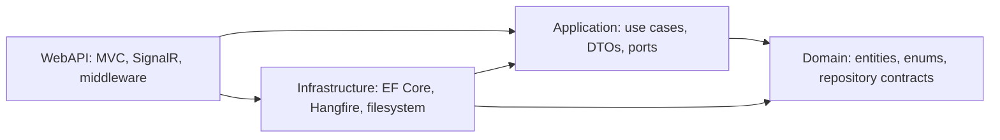
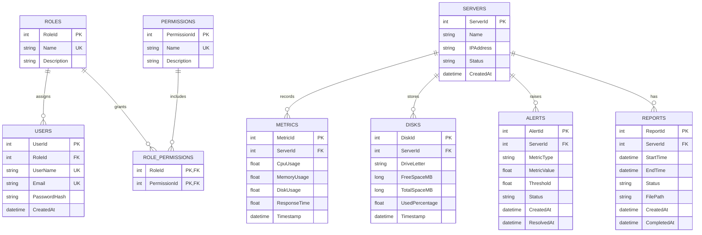

# Architecture

## Overview

The solution uses four projects with dependencies directed toward the domain. Domain defines business entities and repository abstractions; Application coordinates use cases; Infrastructure implements storage and external adapters; WebAPI composes the application and owns HTTP/SignalR presentation.



WebAPI references Infrastructure at the composition root to register implementations. Domain does not reference Application, Infrastructure, WebAPI, EF Core, or Hangfire.

## Layer Responsibilities

### Domain

`Entities/` contains users, roles, permissions, servers, metrics, disks, alerts, and reports. `Enums/` contains the domain statuses. `Interfaces/` contains focused repository contracts, using domain and .NET types without EF Core or HTTP dependencies.

### Application

`Features/` groups use cases, DTOs, and FluentValidation validators by feature. `Common/Interfaces/` contains application ports such as `IUnitOfWork`, file storage, scheduling, password hashing, token creation, and realtime publication. `Common/Exceptions/` holds HTTP-independent expected business failures. `Common/Resources/ValidationMessages.resx` centralizes validation and user-facing business messages.

WebAPI's asynchronous MVC `RequestValidationFilter` resolves and executes validators before controller actions. Services do not inject DTO validators. Global exception middleware maps validation failures to 400 Problem Details with field-specific errors. This filter only covers MVC requests; direct service calls and Hangfire methods bypass it. Database-dependent business checks remain in application services.

### Infrastructure

`Persistence/` contains `ApplicationDbContext`, one EF configuration per entity, and repository implementations. `BackgroundJobs/` contains recurring metric collection, delayed status follow-up, report generation, and report notification continuation jobs. `Services/` implements Hangfire scheduling/monitor adapters, password hashing, JWT tokens, and local report-file storage. Infrastructure registers EF Core and Hangfire and implements Application/Domain contracts.

### WebAPI

`Controllers/` exposes `/api/v1` MVC routes and HTTP response semantics. `Hubs/` exposes the monitoring SignalR endpoint and tracks connection presence. `Middleware/` logs request timings and translates exceptions to Problem Details. `Filters/RequestValidationFilter.cs` automatically runs async FluentValidation rules for controller action arguments. `Common/ApiPagination.cs` contains an HTTP-specific pagination helper.

`Program.cs` keeps configuration reads, registration order, middleware order, recurring-job setup, and endpoint mapping visible. Focused methods in `DependencyInjection.cs` register controllers, security, rate limiting, jobs, realtime, and options. Hangfire implementations and contracts are split across Infrastructure and Application respectively; WebAPI owns only the controller and dashboard exposure.

## Important Workflows

### Metric collection and alerts

A recurring Hangfire job creates random simulated samples for registered server IDs and passes them to `MetricService`. No hardware counters are read and no remote server is contacted.

`MonitoringThresholds` binds from configuration: CPU defaults to 80%, memory to 90%, disk to 90%. When a sample exceeds a threshold, the service creates an active alert or updates the existing alert for that server/metric. A sample at or below threshold resolves an active alert and records `ResolvedAt`. A Down status creates a server-status alert and schedules a five-minute delayed follow-up. The follow-up reads persisted status; it does not ping the host.

The metric, server status, and alert changes are saved before publishing realtime events. `MetricUpdated`, `AlertRaised`, and `AlertResolved` go only to the relevant server SignalR group. Presence updates report connection counts. Clients may also poll for refreshed state.

### Reports and background jobs

The report use case persists a Pending report, then schedules generation through an Application interface. Infrastructure's Hangfire adapter enqueues generation and a continuation. The generation job queries metrics, writes CSV to `Reports:Directory`, stores the generated path in `Report.FilePath`, and updates status/completion time. Download streams a completed file. The continuation logs a simulated notification; it does not send email.

Application holds provider-neutral job monitor DTOs and contracts in `Features/Jobs`. Infrastructure owns Hangfire adapters, job classes, storage, and workers. WebAPI provides `/api/v1/jobs` and the built-in `/hangfire` dashboard. Retrying is allowed only while the current job state is Failed.

### Authentication and roles

Passwords are hashed with ASP.NET Core Identity's `PasswordHasher<User>`. Each user has one `RoleId`; roles grant permissions through `RolePermissions`. JWTs contain role and permission claims; authorization policies check permission claims. Registration assigns the seeded User role.

Users with `users.manage` can create custom roles from existing permission IDs and assign roles by database ID. The last account holding `users.manage` cannot be demoted through the API. Role updates use serializable SQL transactions. Tokens are checked against current database role and permission values; stale tokens are rejected, and the Angular app signs affected users out on the next request or periodic session check.

## Data Model

`database/schema.sql` applies explicit relational constraints to the supplied schema and indexes historical queries. User-to-role is many-to-one. Roles and permissions are many-to-many through composite-key `RolePermissions`. Server-to-metric/disk/alert/report relationships are one-to-many with restrictive deletes so history cannot be cascaded away.



Hangfire owns additional provider-managed SQL tables, omitted from the application diagram. Schema setup/migration is currently SQL-script based, not automated EF migrations.

## Frontend Organization

```text
frontend/src/app/
  core/api/                 HTTP services separated by API resource
  core/auth/                Authentication, guards, auth interceptor
  core/http/                API error interceptor
  core/models/              Frontend contracts
  core/notifications/       Toast state
  core/realtime/            SignalR client
  layout/                   Shared authenticated layout
  pages/<feature>/          Page component, template, SCSS, tests
  shared/pagination/        Reusable pagination component
```

Routes lazy-load standalone pages. The visual UI is custom Angular HTML/SCSS, with Lucide icons and Chart.js visualizations. RxJS handles HTTP Observables, polling, cancellation, and SignalR client integration. List pagination requests backend pages. Server inventory currently loads all server pages and applies search/status filtering client-side, acceptable for demo-sized data but not very large fleets.

## SOLID and Patterns

- **Single responsibility:** HTTP controllers, application workflows, persistence repositories, EF configurations, and external-service adapters have separate responsibilities.
- **Dependency inversion:** Application and Domain define the abstractions; Infrastructure provides implementations.
- **Interface segregation:** repositories and external-service ports are focused around their callers.
- **Repository/unit of work:** persistence operations are abstracted from use cases; EF Core stays in Infrastructure.
- **Adapter:** Hangfire scheduling/monitoring, report files, hashing, token creation, and SignalR publication are implemented behind ports where appropriate.
- **DTO boundary:** API request/response contracts are not EF entities.

`System.Diagnostics` is used in request logging: `Stopwatch` measures request duration and `Activity.Current` supplies a trace ID. It is not used for machine metrics.

## Known Limitations

No refresh-token rotation, alert acknowledgement, role editing/deletion, real machine telemetry, real email, SQL Server concurrency integration tests, WebApplicationFactory API integration tests, shared report storage, SignalR backplane, Docker, CI/CD, or cloud infrastructure templates. See [README.md](README.md) for functionality and [DEPLOYMENT.md](DEPLOYMENT.md) for operational guidance.
