# Real-Time Monitoring Dashboard

A .NET 10 and Angular application built for a senior full-stack technical assessment. It tracks registered servers using simulated metric samples, evaluates threshold alerts, broadcasts updates, generates CSV reports, and exposes background-job monitoring.

## Features

- JWT login and registration with ASP.NET Core Identity password hashing. Every public registration receives the standard User role.
- Single-role-per-user authorization with permission claims and custom role management.
- SQL Server persistence, focused repository interfaces, EF Core configurations, pagination, filtering, and history indexes.
- Recurring simulated metric collection, delayed server-status follow-up, asynchronous report generation, and a Hangfire continuation.
- CPU, memory, disk, and server-status alerts with persistence and recovery state.
- Per-server SignalR groups for metric events, alerts, and connection presence.
- CSV reports stored as files with the path tracked in SQL Server.
- Angular dashboard for overview, servers, metric history, alerts, reports, jobs, and users/roles.
- Global Problem Details handling, FluentValidation, Serilog, health endpoint, Swagger/OpenAPI, and request logging.

Metric values are simulated by the recurring collector. The application does not read real machine counters or remotely monitor physical servers.

## Screenshots

Screenshots use representative browser-only responses to show the UI. They are not live database or SignalR captures; the source images are in `docs/demo/`.

### Sign In

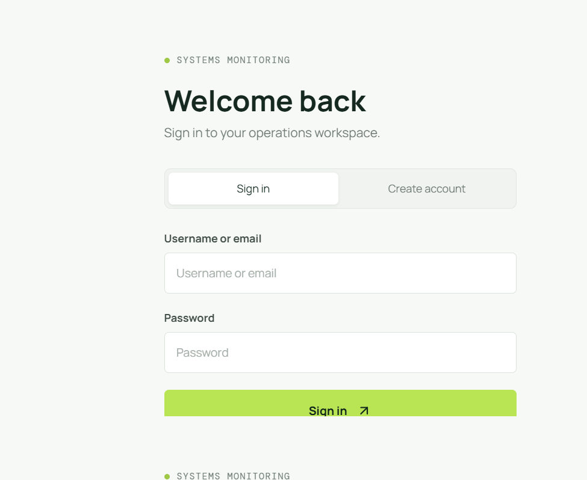

### Monitoring Overview

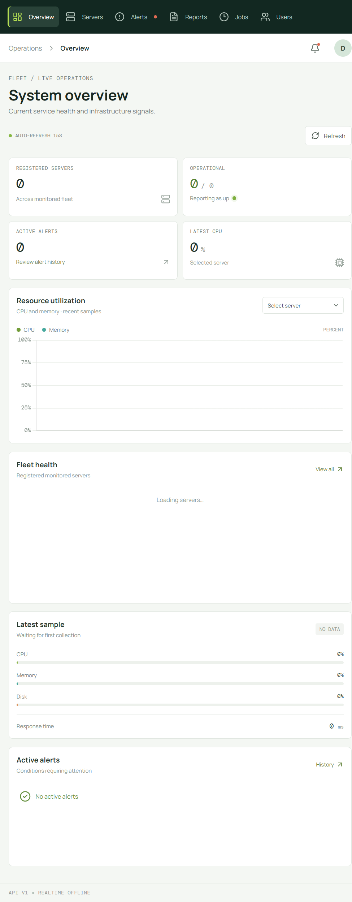

### Server Inventory

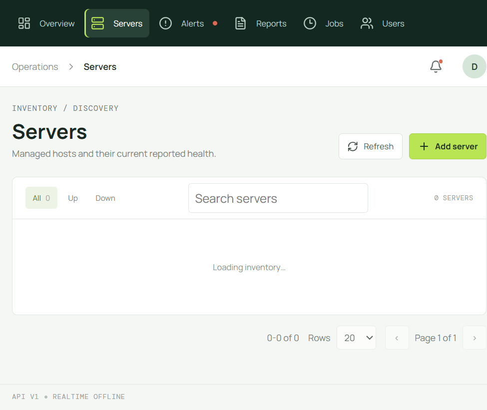

### Server Metric History

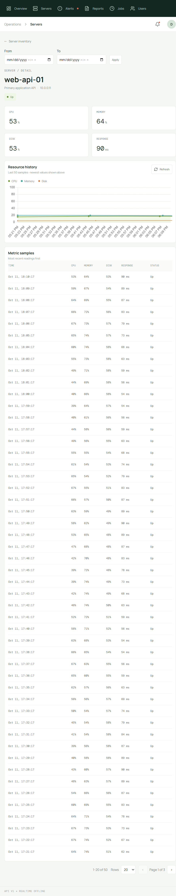

### Alert History

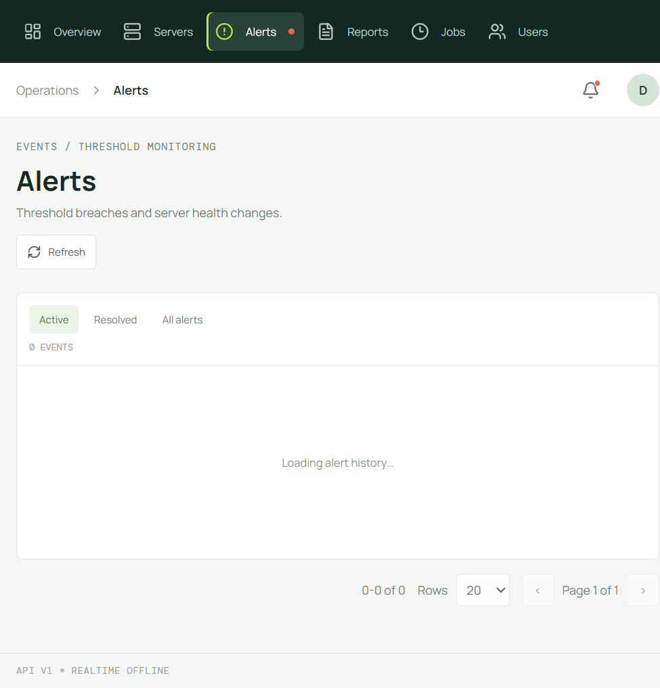

### Reports

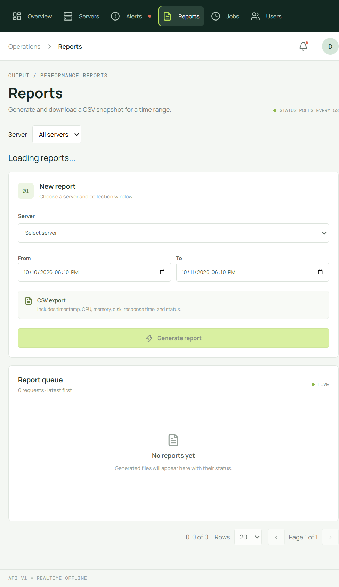

### Background Jobs

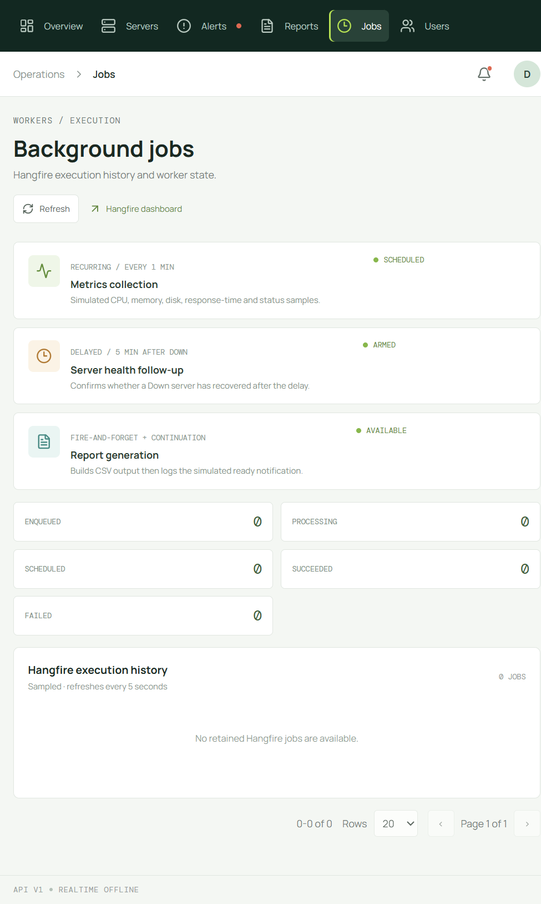

### User Management

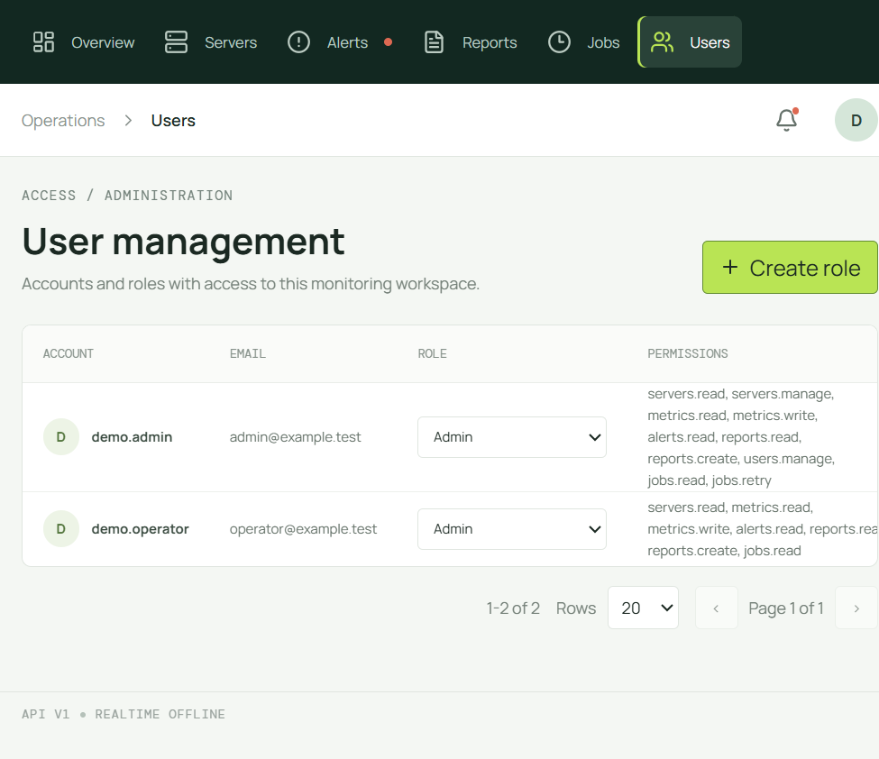

### Role Assignment

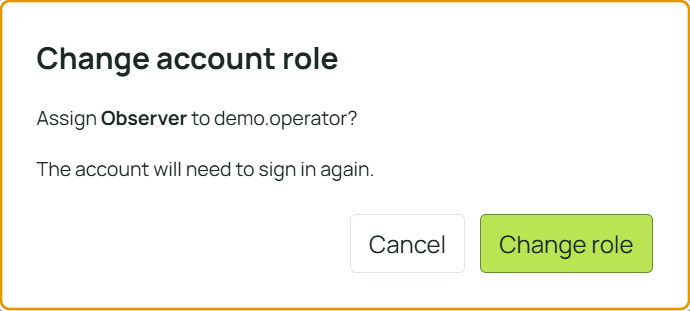

### Create a Role

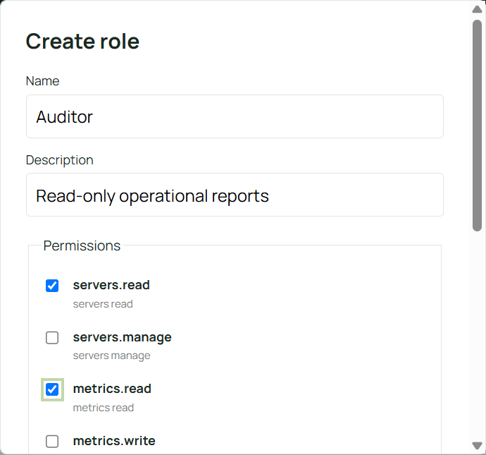

### API Error Feedback

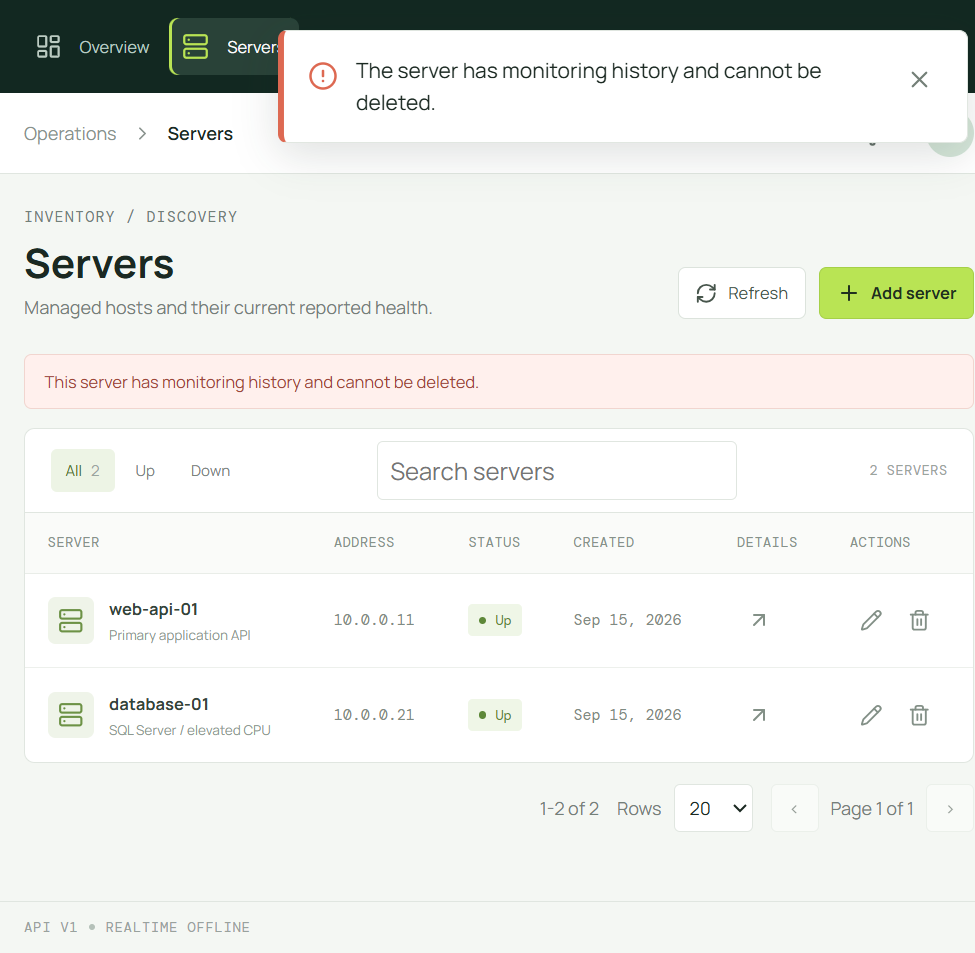

## Technology

- **Backend:** .NET 10, ASP.NET Core MVC, EF Core 10, SQL Server, JWT, FluentValidation, Serilog.
- **Jobs:** Hangfire with SQL Server storage.
- **Realtime:** ASP.NET Core SignalR.
- **Frontend:** Angular 21 standalone components, TypeScript, RxJS, Chart.js, Lucide Angular, custom HTML/SCSS.
- **Tests:** xUnit; Angular CLI test runner using Vitest and jsdom.

## Repository Layout

```text
src/
  MonitoringDashboard.Domain/          Entities, enums, repository contracts
  MonitoringDashboard.Application/     Use cases, validators, DTOs, ports
  MonitoringDashboard.Infrastructure/  EF Core, Hangfire, file and security adapters
  MonitoringDashboard.WebAPI/          Controllers, hub, middleware, composition
frontend/src/app/
  core/api/                             HTTP services grouped by resource
  core/auth/                            Session, guards, auth interceptor
  core/http/                            API error interceptor
  core/models/                          Client-side contracts
  core/notifications/                   Toast state
  core/realtime/                        SignalR client
  layout/                               Shared authenticated layout
  pages/<feature>/                      Page component, template, styles, tests
  shared/pagination/                    Reusable list pagination
 tests/MonitoringDashboard.Tests/       Backend model/workflow/security tests
 database/                              SQL schema and admin scripts
 docs/demo/                             Screenshot assets
```

## Prerequisites

- .NET 10 SDK.
- SQL Server.
- `sqlcmd` or SQL Server Management Studio.
- Node.js 22.12+ and npm.

## Getting Started

1. Configure a SQL Server connection string and JWT settings for your target environment. See [DEPLOYMENT.md](DEPLOYMENT.md) for configuration keys and hosting guidance. The JWT signing key must be random and at least 32 UTF-8 bytes.
1. Run `database/schema.sql` against the target database. It creates tables, constraints, indexes, roles, permissions, and a demonstration server. It also migrates legacy `UserRoles` assignments when present. Hangfire creates its own storage objects at API startup.
1. Build and start the API:

  ```powershell
  dotnet build MonitoringDashboard.sln --configuration Release
  dotnet run --project src/MonitoringDashboard.WebAPI --configuration Release
  ```

1. Build the frontend for static hosting, or run its development server while developing:

  ```powershell
  Set-Location frontend
  npm install --legacy-peer-deps
  npm run build
  ```

  For frontend development, run `npm start`; its proxy is configured for the default HTTPS development API at `https://localhost:7179`. Change `frontend/src/proxy.conf.json` to match a different development API address.

1. Point users to the URL where the frontend is hosted. Route `/api` and `/hubs` to the WebAPI in the hosting environment.

For an assessment demonstration environment only, `database/seed-demo-admin.sql` adds the public account `demo.admin` / `DemoAdmin!2026`. Never run that seed in Production; it does not reset an existing account. For Production, register an account with a private password and promote it using `database/promote-admin.sql`. Public registration always grants User.

Swagger UI is at `/swagger`, OpenAPI JSON at `/openapi/v1.json`, and Hangfire dashboard at `/hangfire`. Current startup maps these routes in every environment. Hangfire's default authorization is local-only; gate these routes by environment and configure explicit dashboard authorization before Production exposure.

## Build and Test

```powershell
dotnet restore MonitoringDashboard.sln
dotnet build MonitoringDashboard.sln
dotnet test MonitoringDashboard.sln
```

Frontend checks:

```powershell
Set-Location frontend
npm run build
npx ng test --watch=false
```

## API At A Glance

Base path: `/api/v1`. Protected routes use `Authorization: Bearer <access-token>`. Creation endpoints return 201 with a response body and no `Location` header.

- Authentication: `POST /auth/register`, `POST /auth/login`, and `GET /users/me` register, authenticate, and inspect current claims.
- Servers: `GET/POST /servers` and `GET/PUT/DELETE /servers/{id}` list and manage server records.
- Metrics: `GET /servers/{id}/metrics` reads paginated history; Hangfire performs metric collection.
- Alerts: `GET /alerts` filters and pages alert history.
- Reports: `POST /servers/{id}/reports`, `GET /reports`, `GET /reports/{id}`, and `GET /reports/{id}/download` queue, inspect, and download CSV reports.
- Jobs: `GET /jobs` lists job history; `POST /jobs/{jobId}/retry` retries jobs still in Failed state.
- Users/roles: `GET /users`, `PUT /users/{id}/role`, `GET/POST /roles`, and `GET /roles/permissions` support permission-protected user and role management.
- Operations: `GET /health`, `/swagger`, `/openapi/v1.json`, and `/hangfire` expose liveness, API documentation, and Hangfire monitoring.

See [ARCHITECTURE.md](ARCHITECTURE.md) for application behavior and [DEPLOYMENT.md](DEPLOYMENT.md) for configuration and hosting guidance.
See [AI-USE.md](AI-USE.md) for the AI-assisted development disclosure.
